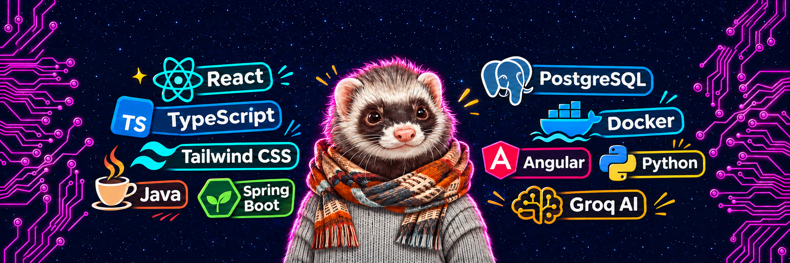

<h1 align="center">🐞 ¡Bienvenidos a mi código, donde los bugs vienen de serie! 🐞</h1>

  <strong>Desarrolladora web · Apasionada por aprender · Siempre en evolución</strong>

  
  

---

## 👩🏻‍💻 ¡Hola! Soy Sandra

¡Hola! Soy **Sandra Fernández Cañete**, desarrolladora web apasionada por crear **soluciones funcionales, bien estructuradas y eficientes**.  

🎓 **Formación:** 

  - Bootcampt Data Analyst - Fundación Arrabal en colaboración con Somos F5. **Cursando Actualmente**
  - Bootcampt FullStack Java, Computer Programming - Fundación Esplai - Talent IT
  - Grado Superior en Desarrollo de Aplicaciones Web (DAW) – Cesur  

💡 Me encanta aprender continuamente y aplicar lo que aprendo en proyectos reales. Actualmente busco **oportunidades de empleo en frontend** donde pueda crecer profesionalmente y aportar valor a un equipo de desarrollo.

---

## 💻 Experiencia

### Prácticas en **Codearts** – Frontend Developer
- Participé en la construcción de una **aplicación web desde sus primeras fases** utilizando **Angular**.  
- Colaboré estrechamente con el equipo de backend en **Symfony**, entendiendo cómo se conectan ambas partes de un proyecto completo.  
- Trabajamos bajo un **entorno ágil**, con reuniones diarias, planificación por sprints y comunicación constante, lo que me permitió conocer el funcionamiento real de un equipo profesional de desarrollo.  

---

## 🚀 Proyectos en Curso

- Sigo desarrollando de manera personal el proyecto **DonTacaño.com**, un comparador de precios, con el objetivo de **ampliar mis conocimientos, poner en práctica nuevas tecnologías y técnicas, y continuar mejorando mis habilidades de programación**. Este proyecto me permite explorar soluciones más avanzadas, experimentar con nuevas funcionalidades y mantenerme en constante aprendizaje para afrontar retos futuros en el desarrollo web(Ver repositorio [DonTacaño.com](https://github.com/Sfernan92/TuComparadorDePreciosPlus)).
  
- Actualmente desarrollo **Darpalis Exotics**, una propuesta de plataforma web para una tienda especializada en animales exóticos. El proyecto incluirá catálogo de animales y productos, fichas informativas, sistema de usuarios y gestión de pedidos. Su desarrollo me permitirá profundizar en React, Python, FastAPI y PostgreSQL mientras creo una solución real para la tienda Darpalis(Ver repositorio [Darpalis Exotics](https://github.com/Sfernan92/Darpalis_Exotics)).

---

## ✅ Proyectos Realizados

- He desarrollado junto a un equipo de **5 personas** el proyecto final **CRM Esplai**, **mAIte, CRM de empleabilidad con IA**, una aplicación de gestión para facilitar el acompañamiento e inserción laboral de alumnado. La plataforma permite gestionar alumnos, empresas, vacantes, candidaturas, entrevistas y seguimiento, incorporando además análisis de afinidad mediante IA. En este proyecto trabajé con **React, TypeScript, Tailwind CSS, Java, Spring Boot, PostgreSQL, Docker y Python**, reforzando mis conocimientos de desarrollo full-stack, trabajo colaborativo y arquitectura de aplicaciones(Ver repositorio [CRM mAIte](https://github.com/Sfernan92/CRMEsplai_Showcase)).

---

## 🎯 Objetivo profesional

Mi objetivo es **seguir creciendo profesionalmente en el ámbito del desarrollo de software**, formando parte de un equipo donde pueda **adquirir experiencia, afianzar mis conocimientos y aprender de profesionales con más recorrido**. Me motiva afrontar nuevos retos, compartir ideas y poner en práctica lo aprendido, aportando dedicación, responsabilidad y ganas de seguir mejorando en cada proyecto.

---

## 📚 Formación y aprendizaje continuo
- Sigo ampliando mis conocimientos con **cursos especializados, certificaciones, formaciones complementarias y proyectos personales**.  
- Me gusta explorar nuevas tecnologías, mejorar mi lógica de programación y aplicar lo aprendido en **pequeñas aplicaciones y prácticas reales**.  
- Dedico tiempo a **repasar conceptos clave, documentarme y mantenerme al día con las tendencias del sector**, porque creo firmemente que en tecnología la formación continua es esencial.  

---

## 🌱 Habilidades y cualidades

- **Frontend:** Angular, React, HTML, CSS, JavaScript.  
- **Backend:** Conceptos básicos de Symfony, Java, Python, APIs REST.  
- **Metodologías ágiles:** Scrum, sprints, reuniones diarias.  
- **Soft skills:** Constante, organizada, actitud de superación, colaborativa, mente abierta.

---

## 💻 Tech Stack:

---

## 📫 Contacto
- ✉️ Email: `sandriita_92@hotmail.com`  
- 💼 LinkedIn: `www.linkedin.com/in/sandrafernández`  
- 🌐 Portfolio/Proyectos: **EN CONSTRUCIÓN** ⛏

---

  Gracias por pasarte por mi perfil 💜
   
  <em>Seguimos aprendiendo... ¡y atrapando bugs por el camino! 🐞</em>

